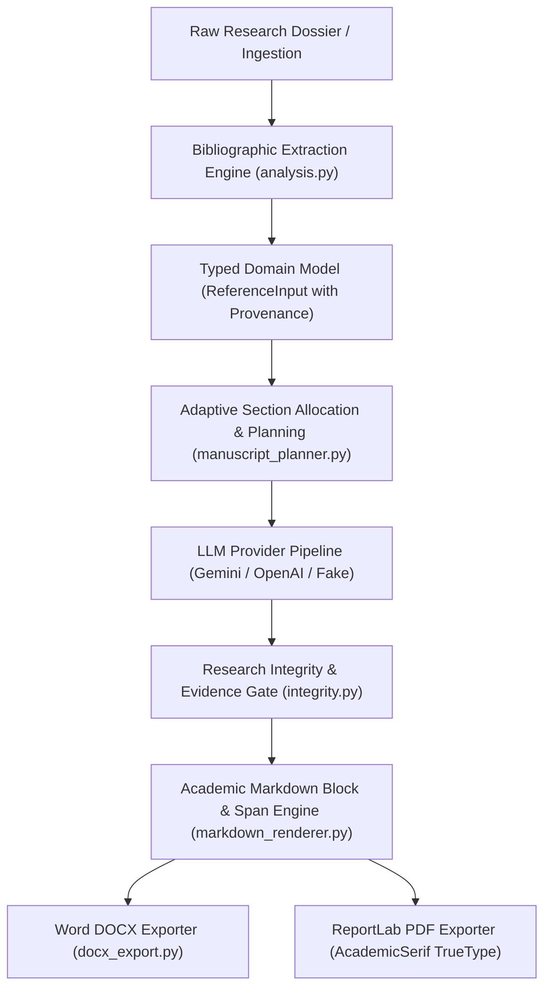

# 19 — Reference Integrity, Structured Schema & Academic Document Rendering Specification

## Executive Summary

This engineering specification documents the architectural overhaul of Resbud's academic document generation, citation integrity, and manuscript rendering pipeline. It resolves six critical defects identified in previous generation artifacts (including `66912c70-92e9-4abe-bd5b-40ebcbfb70ec.pdf`) and fixes the transient schema validation error (`project contains unsupported fields`) during image and figure uploads.

---

## 1. System Design and Architectural Decisions

The previous architecture suffered from tight coupling between unstructured Markdown text and export rendering, naive regex tokenizers that destroyed multi-line bibliographic citations, Latin-1 typeface restrictions in PDF generation, and leaky client payloads.

The overhaul introduces five dedicated subsystems:

### Key Architectural Decisions:
1. **Separation of Structure from Markdown:** Section headings are stored as clean plain-text strings in `PaperSection.heading` and rendered with deterministic hierarchical numbering (`1.`, `1.1`, `1.1.1`). Markdown heading markers (`#`, `##`, `###`, `####`) inside section content are parsed into distinct subheadings rather than dumped as literal strings.
2. **Authoritative Reference Provenance:** References are never synthesized or invented by LLMs. When research material is ingested, multi-line bibliographic blocks are extracted deterministically into structured metadata (`authors`, `year`, `title`, `venue`, `doi`, `provenance`, `verification_status`).
3. **Dedicated TrueType Unicode Font Stack:** ReportLab's standard Type 1 `Times-Roman` font (restricted to Latin-1/WinAnsi) was replaced with registered TrueType fonts (`LiberationSerif` with `DejaVuSerif` fallback). This eliminates Unicode character corruption such as `O■uz` for `Barlas Oğuz`.
4. **Resilient Project Context Ingestion:** `GenerationRequest.fromInputs` and `ProjectContextPayload` strip or permit transient client fields (such as `figures`, `description`, `creation_mode`), eliminating client-side schema rejections.

---

## 2. Reference Integrity Strategy

### 2.1 Provenance Tracking & Verification Status
Every reference tracked by Resbud possesses explicit provenance and verification status:
- **`user_supplied`**: Explicitly supplied by the researcher or extracted from the user's primary source dossier.
- **`extracted`**: Parsed automatically from uploaded documents or PDFs.
- **`crossref_verified` / `doi_verified`**: Metadata verified against official DOI registrar or publisher databases.
- **`unverified`**: Retained verbatim with missing-field disclosures.
- **`citation_needed`**: Transparent placeholder for ungrounded prose claims.

### 2.2 Extraction Engine Improvements (`extract_bibliographic_references`)
Previous regex implementations (`re.findall(r"\[...\]\s*([^\n]+)", text)`) truncated citations at the first newline. For Cormack et al. (2009), the title spanning lines 2–3 was lost, causing the LLM to hallucinate `"Reciprocal rank fusion outperforms rank introducing variables for rank-merging"`.

The new parser:
1. Accumulates contiguous lines within bracketed citation blocks `[1]`, `[ref_1]`, etc.
2. Extracts full multi-line titles enclosed in quotations (`"..."`, `“...”`).
3. Retains DOIs (`10.1145/...`) and arXiv identifiers.
4. Normalizes whitespace while preserving author diacritics.

### 2.3 Strict Bibliography Isolation
References are strictly isolated from body prose:
- The `References` section is removed from `desired_sections` and generated body sections.
- Exporters render the `References` section at the document terminus with standard IEEE numbered formatting (`[1]`, `[2]`) and hanging indents.
- Literature-review prose and `### Analysis` subsections are forbidden from appearing in the bibliography.

---

## 3. Document-Rendering Specification

### 3.1 Markdown Parsing Engine (`markdown_renderer.py`)
Markdown rendering does not rely on naive global regex replacements. A multi-phase block and inline parser operates as follows:
- **Block Types Supported:**
  - `heading`: Levels 1 through 4 with hierarchical numbering (`1.`, `1.1`, `1.1.1`).
  - `paragraph`: Standard prose containing styled inline spans.
  - `table`: Markdown pipe tables converted to Word tables (`Table Grid` style) and ReportLab `Table` objects with cell padding and alternate row shading.
  - `figure`: Inline markdown images `` and base64 payloads rendered with centered alignment and caption labels.
  - `equation`: LaTeX equations parsed into OMML (Office Math Markup Language) for DOCX and high-res vector/image representations for PDF.
  - `list`: Unordered and ordered lists with hanging indents.

### 3.2 Typography & Font Handling

| Output Format | Primary Font | Heading Style | Unicode Handling |
| :--- | :--- | :--- | :--- |
| **DOCX** | Liberation Serif / Times New Roman (10pt, 1.15 line spacing) | Bold Serif (16pt Title, 13pt H1, 11pt H2, 10pt H3) | Native OpenXML UTF-8 encoding |
| **PDF** | `AcademicSerif` (LiberationSerif-Regular.ttf, 10pt / 14pt leading) | Bold Serif (18pt Title, 13pt H1, 11pt H2) | TrueType font registration with FreeType CIDFont |

### 3.3 Automatic Hierarchical Section Numbering
- **Source of Truth:** Automatic numbering is driven by document hierarchy.
- **Rules:**
  - `Abstract`, `Keywords`, and `References` are unnumbered headings.
  - Main sections are numbered `1. `, `2. `, `3. `.
  - Subsections are numbered `1.1 `, `1.2 `, `2.1 `.
  - Sub-subsections are numbered `1.1.1 `, `1.1.2 `.
  - Manual numbers present in input titles (e.g. `1.1 Context & Motivation`) are stripped prior to rendering to avoid double numbers (e.g. `1.1 1.1 Context`).

---

## 4. Test Coverage Summary

### Automated Test Suite:
1. **Backend Tests (168 passed):**
   - `tests/test_critical_manuscript_quality_regression.py`: Tests heading unescaping, Unicode `Oğuz` rendering, Cormack reference title extraction, and section numbering.
   - `tests/test_docx_export_api.py`: Word export, OMML equations, tables, and styles.
   - `tests/test_pdf_export_api.py`: ReportLab export, TrueType font setup, pagination, and multi-page flows.
   - `tests/test_research_integrity.py`: Adversarial prompts, unconducted experiment disclosures, and citation guards.
   - `tests/test_end_to_end_integration.py`: Vertical generation, section regeneration, and document parsing.
   - `tests/test_gemini_provider.py`: Gemini LLM adapter with structured output schema.
2. **Mobile Tests (165 passed):**
   - `test/generation_api_test.dart`: Serialization, figure handling, and transient field stripping.
   - `test/paper_editor_page_test.dart`: UI editor, section regeneration, and DOCX/PDF export actions.

---

## 5. Migration Notes & Wire Compatibility

- **JSON Schema:** `contracts/paper-draft.schema.json` and `contracts/generation-request.schema.json` remain 100% backward-compatible. Legacy clients sending only `{"id": "...", "text": "..."}` continue to function without modification.
- **Optional Metadata:** Structured fields (`authors`, `year`, `title`, `venue`, `doi`, `url`, `provenance`, `verification_status`) are nullable and omitted when absent.
- **Database / Version Storage:** Existing saved `PaperVersion` snapshots deserialize cleanly without migration scripts.
