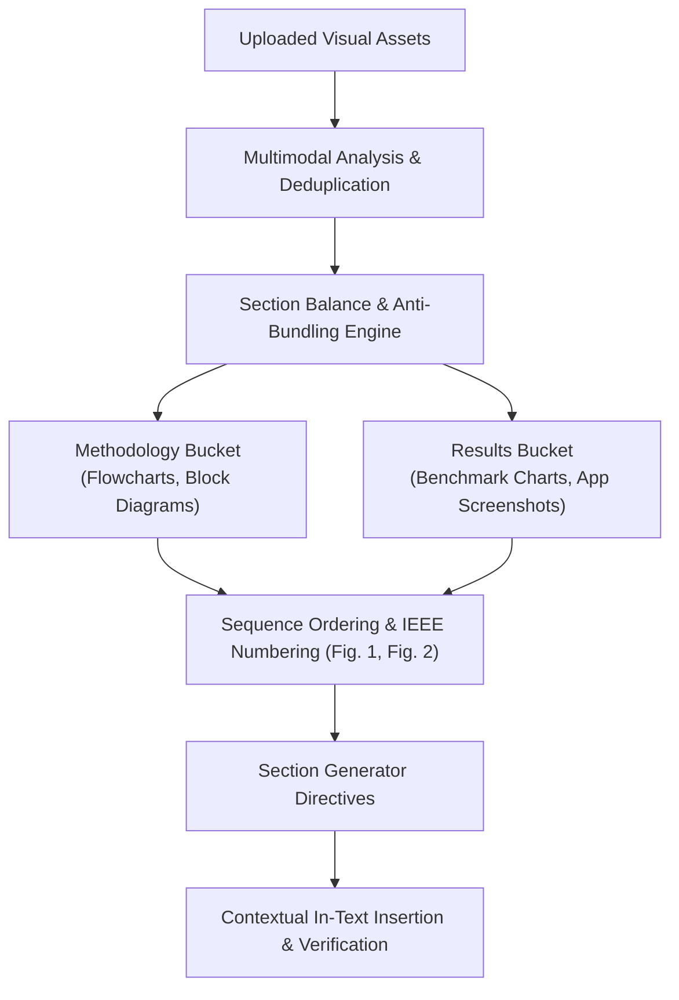

# 36. Semantic Figure Management and Intelligent IEEE Image Placement

## Architecture & System Specification

### Executive Summary

Resbud produces publication-grade academic manuscripts conforming strictly to IEEE conference and journal standards. Prior to this release, uploaded images were subject to naive end-of-section or end-of-document bundling: when figures were not referenced in text, the generator appended all visual assets into a single trailing section.

This specification establishes Resbud's **Semantic Figure Management and Intelligent Placement Pipeline**. It guarantees:
1. **Zero Figure Bundling**: Figures are contextually distributed throughout the manuscript adjacent to their specific conceptual discussion blocks.
2. **Multimodal Analysis & Deduplication**: Every image is categorized (flowcharts, architecture diagrams, benchmark graphs, user-interface screenshots, photographs, tables) and verified for relevancy and novelty before document insertion.
3. **Structured Figure Placement Planning**: Prior to prose generation, an explicit `FigurePlacementPlan` establishes section assignment, in-text anchor paragraphs, layout width mode, and sequential IEEE ordering.
4. **Contextual In-Text Integration**: In-text introductions (`as shown in Fig. 1`), embedded visual blocks, bottom-anchored IEEE captions, and follow-up analytical discussions are seamlessly coordinated.
5. **IEEE Visual & Typographic Standards**: Captions use the mandatory `Fig. N.` prefix, 8.5–9 pt Times New Roman typography, bottom placement, and aspect-ratio-preserving single-column (max 3.5 in / 252 pt) or full-width (6.2–6.5 in) scaling.
6. **Dynamic Renumbering & Cross-Referencing**: When figures are reordered, added, or relocated, all figure numbers and in-text references are updated automatically in chronological reading order.
7. **Zero Silent Loss**: Unplaced, ambiguous, or duplicate figures are never silently discarded; they remain visible in manuscript assets with explanatory rationale and review warnings.

---

## 1. Structured Figure Model

The figure pipeline operates on an immutable, contract-backed `StructuredFigure` object across the FastAPI backend, JSON schemas, OpenAPI specifications, and Flutter client models.

```json
{
  "id": "FIG-001",
  "filename": "methodology_pipeline.png",
  "caption": "Fig. 1. End-to-end landmark detection and metric extraction pipeline.",
  "storage_key": "projects/proj_123/figures/FIG-001.png",
  "data_uri": "data:image/png;base64,iVBORw0KGgo...",
  "width": 1280,
  "height": 720,
  "mime_type": "image/png",
  "title": "Methodology Pipeline",
  "description": "Flowchart detailing the multi-stage landmark detection and normalization pipeline.",
  "category": "flowchart",
  "related_section": "methodology",
  "target_anchor": "Immediately following the overview of data acquisition and landmark detection.",
  "placement_rationale": "Contextually placed in methodology adjacent to geometric formulation.",
  "preferred_placement": "after_paragraph",
  "column_span": "column_width",
  "figure_order": 1,
  "referenced_in_text": true,
  "placement_status": "assigned"
}
```

### Core Metadata Attributes

| Attribute | Type | Description |
| :--- | :--- | :--- |
| `id` | `string` | Unique durable figure identifier (e.g., `FIG-001`, `fig_1`). |
| `filename` | `string` | Original asset filename (e.g., `methodology_flowchart.png`). |
| `caption` | `string` | Formatted descriptive caption, conforming to IEEE `Fig. N.` prefix. |
| `storage_key` | `string?` | Remote/local object storage reference. |
| `data_uri` | `string?` | RFC 2397 base64 data URI for in-memory document rendering. |
| `width`, `height` | `int` | Native pixel dimensions extracted during image inspection. |
| `mime_type` | `string` | Verified MIME type (`image/png`, `image/jpeg`, `image/webp`, etc.). |
| `title` | `string?` | Descriptive short title for editor indexing. |
| `description` | `string?` | Semantic summary of visual content used by the generation planner. |
| `category` | `enum` | Classified visual type: `flowchart`, `architecture_diagram`, `screenshot`, `graph`, `photograph`, `experimental_result`, `table_image`, `other`. |
| `related_section` | `string?` | Target manuscript section ID (`methodology`, `results`, etc.). |
| `target_anchor` | `string?` | Anchor paragraph topic or concept for contextual embedding. |
| `placement_rationale`| `string?` | Formal explanation of placement logic or review flag. |
| `preferred_placement`| `enum` | Vertical positioning preference: `after_paragraph`, `top_of_column`, `bottom_of_column`, `inline`. |
| `column_span` | `enum` | Horizontal span: `column_width` (single column) or `full_width` (spanning both columns). |
| `figure_order` | `int` | Sequential 1-based order of appearance in the manuscript. |
| `referenced_in_text` | `bool` | Whether an in-text reference citation exists in the prose. |
| `placement_status` | `enum` | Lifecycle state: `assigned`, `suggested`, `unplaced`, `omitted`. |

---

## 2. Multimodal Figure Analysis

Every uploaded image undergoes automated semantic analysis (`resbud_api.services.figure_analyzer`):

1. **Independent Categorization**: Inspects image filenames, titles, descriptions, and captions against domain-specific lexical indicators to categorize assets into formal academic figure taxonomies:
   - `flowchart`: Process pipelines, state machines, workflow sequences.
   - `architecture_diagram`: System components, block diagrams, edge-to-cloud infrastructure.
   - `screenshot`: Mobile application UIs, web dashboards, prototype screens.
   - `graph`: Loss curves, ROC distributions, scatter plots, confusion matrices.
   - `experimental_result`: Quantitative benchmark charts, ablation bar charts.
   - `photograph`: Laboratory apparatus, physical hardware, microscopy specimens.
   - `table_image`: Tabular visual summaries.
2. **Duplicate Detection**: Computes SHA-256 cryptographic hashes of raw image data URIs and storage keys. When duplicate visual content is identified, duplicate figures are flagged with `placement_status = "omitted"` and annotated with `placement_rationale = "Identified as duplicate of figure {primary_id}."`.
3. **Semantic Section Mapping**:
   - `flowchart` & `architecture_diagram` $\rightarrow$ mapped to `methodology` or `proposed_system`.
   - `graph` & `experimental_result` $\rightarrow$ mapped to `results` or `empirical_evaluation`.
   - `screenshot` $\rightarrow$ mapped to `results` (mobile app deployment / prototype interface) or `methodology` (data collection interface).
   - `photograph` $\rightarrow$ mapped to `methodology` (experimental apparatus).
4. **Ambiguity & Relevancy Assurance**: Assets lacking semantic description, title, or contextual relevance are marked `placement_status = "unplaced"` and flagged for author review.
5. **Zero Hallucination Guarantee**: The analyzer never fabricates empirical numbers or laboratory conclusions based on an image alone.

---

## 3. Figure Placement Planning & Anti-Bundling Engine

Before section-by-section prose expansion begins, `resbud_api.services.figure_planner` constructs a balanced `FigurePlacementPlan`:



### Anti-Bundling Invariants
- **No Clustered Dumps**: If an author uploads multiple figures, they are distributed across relevant sections (e.g., flowcharts in Methodology, charts in Results).
- **Paragraph Striding**: When multiple figures reside within the same section, they are interleaved between distinct conceptual paragraphs using stride calculation (`stride = paragraphs.length / (figures.length + 1)`), rather than adjacent stacking.
- **First-Page Protection**: Figures are never packed onto the first page ahead of foundational problem formulation.

---

## 4. Contextual In-Text Integration

In academic publishing, a figure cannot exist in isolation. Every placed figure satisfies a strict four-part invariant:

```
[ Introductory Prose ]
"As illustrated in Fig. 1, the end-to-end framework comprises three primary stages..."

[ Embedded Figure Block ]


[ Caption Below ]
Fig. 1. End-to-end landmark detection and metric extraction pipeline.

[ Follow-Up Technical Analysis ]
"The visual components formalize operational interactions, providing verifiable structural grounding for the subsequent algorithmic transformations..."
```

1. **Preceding In-Text Citation**: Authors and readers encounter an explicit reference (`Fig. N`) before the graphic.
2. **Embedded Visual Flowable**: Rendered at publication resolution, maintaining strict aspect ratio.
3. **Caption Below**: Positioned strictly beneath the figure, never above (above-positioning is reserved for tables).
4. **Follow-Up Technical Discussion**: Subsequent paragraphs evaluate the implications shown in the graphic.

---

## 5. IEEE Figure Formatting Conventions

Both ReportLab PDF generation and python-docx OMML exporters adhere strictly to IEEE publication manual conventions:

### Typographic Specifications
- **Numbering Prefix**: Strict `Fig. N.` format (e.g., `Fig. 1.`, `Fig. 2.`). The unabbreviated word `Figure` is reserved exclusively for sentence openings.
- **Font & Size**: Times New Roman, 8.5 pt to 9.0 pt.
- **Caption Styling**: Prefix `Fig. N.` formatted in bold, followed by a period, space, and the descriptive caption.
- **Alignment**: Single-line captions are centered beneath the figure; multi-line captions are justified or left-aligned per IEEE template requirements.
- **Spacing**: 6 pt spacing before figure, 2 pt between figure and caption, 8–12 pt after caption.

### Layout Dimensions & Scaling

| Layout Mode | Target Width (in) | Target Width (pt) | Maximum Height (pt) | Use Case |
| :--- | :--- | :--- | :--- | :--- |
| **Column Width** (`column_width`) | 3.2 – 3.5 in | 230 – 252 pt | 240 – 280 pt | Single-column figures fitting inside one column of a two-column IEEE grid (mobile screenshots, vertical flowcharts, individual ROC plots). |
| **Full Page Width** (`full_width`) | 6.2 – 6.5 in | 446 – 468 pt | 320 – 360 pt | Wide multi-panel architecture diagrams, broad benchmark tables, parallel comparison charts. |

---

## 6. Dynamic Renumbering and Cross-Referencing

If an author reorders figures, removes a graphic, or shifts an asset between sections, `resbud_api.services.figure_distributor` automatically:
1. Performs a single-pass chronological scan in document reading order.
2. Re-indexes figure numbers starting at 1 (`Fig. 1.`, `Fig. 2.`, `Fig. 3.`, ...).
3. Updates markdown image markers with normalized captions: ``.
4. Normalizes all in-text references (`Figure 1`, `fig. 1`, `FIG-001`) to canonical IEEE citations (`Fig. {N}`).
5. Sets `referenced_in_text = True` and updates `figure_order` on the structured model.

---

## 7. Mobile Figure Manager & User Controls

The Flutter mobile client (`mobile/lib/features/project_input/project_input_page.dart`) exposes comprehensive figure management controls in the research input editor:

- **Thumbnail Preview**: Renders thumbnail cards from image bytes or local storage.
- **Editable Caption & Description**: Real-time form fields allowing authors to refine captions and semantic descriptions passed to the generation model.
- **Target Section Dropdown**: Authors can explicitly bind a figure to a specific section (`Introduction`, `Methodology`, `Results`, `Discussion`, `Conclusion`) or leave it on `Auto (AI planned)`.
- **Layout Width Toggle**: Switch between **Column Width** (fits single IEEE column) and **Full Page Width** (spans both columns).
- **Interactive Reordering**: **Move Up** and **Move Down** buttons allow authors to adjust sequence order before generation.
- **Placement Status Badges**: Visual indicator of asset state (`Assigned`, `Suggested`, `Unplaced`, `Omitted`).
- **Asset Removal**: Instant figure deletion from project storage.

---

## 8. Failure Handling & Non-Discard Guarantee

- **Zero Silent Loss**: If an uploaded image cannot be contextually placed (e.g., due to an extremely brief user prompt without relevant sections), the asset is marked `placement_status = "unplaced"`.
- **Review Warnings**: The system surfaces a typed `ReviewWarning` (`code = "GENERAL_REVIEW"`, `severity = "info"`) informing the user:
  `"Figure 'flowchart.png' (FIG-001) was retained in figure assets with status 'unplaced': contextual purpose unclear from provided visual metadata."`
- **Corrupted Byte Handling**: If an image cannot be parsed, a structured fallback placeholder block `[Fig. N: Caption]` is rendered, ensuring compilation and export never abort with 500 errors.

---

## 9. Verification & Regression Test Suite

The semantic figure placement architecture is validated by automated regression suites:
- `backend/tests/test_semantic_figure_placement.py`:
  - `test_structured_figure_model_fields_and_defaults`: Contract validation.
  - `test_multimodal_analysis_categorization`: Categorizes flowcharts, architecture diagrams, graphs, screenshots.
  - `test_multimodal_analysis_section_mapping`: Maps assets to Methodology and Results.
  - `test_duplicate_figure_detection`: Detects identical image hashes and marks omitted.
  - `test_ambiguous_figure_flagged_for_user_review`: Flags ambiguous uploads.
  - `test_figure_placement_planning_anti_bundling`: Verifies balanced cross-section distribution.
  - `test_clean_ieee_caption_text`: Normalizes captions.
  - `test_distribute_and_reindex_figures_contextual_insertion`: In-text weaving and sequential numbering.
  - `test_six_figure_regression_manuscript`: End-to-end regression using 6 distinct figures (flowchart, algorithm diagram, benchmark chart, 2 mobile screenshots, architecture diagram) exported to valid DOCX and PDF documents.
- `mobile/test/semantic_figure_placement_test.dart`: Validates Flutter models, serialization, and mobile distributor.
