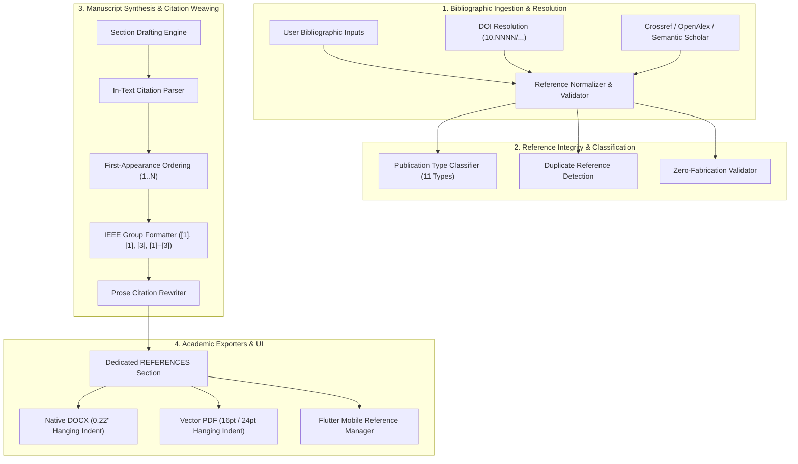
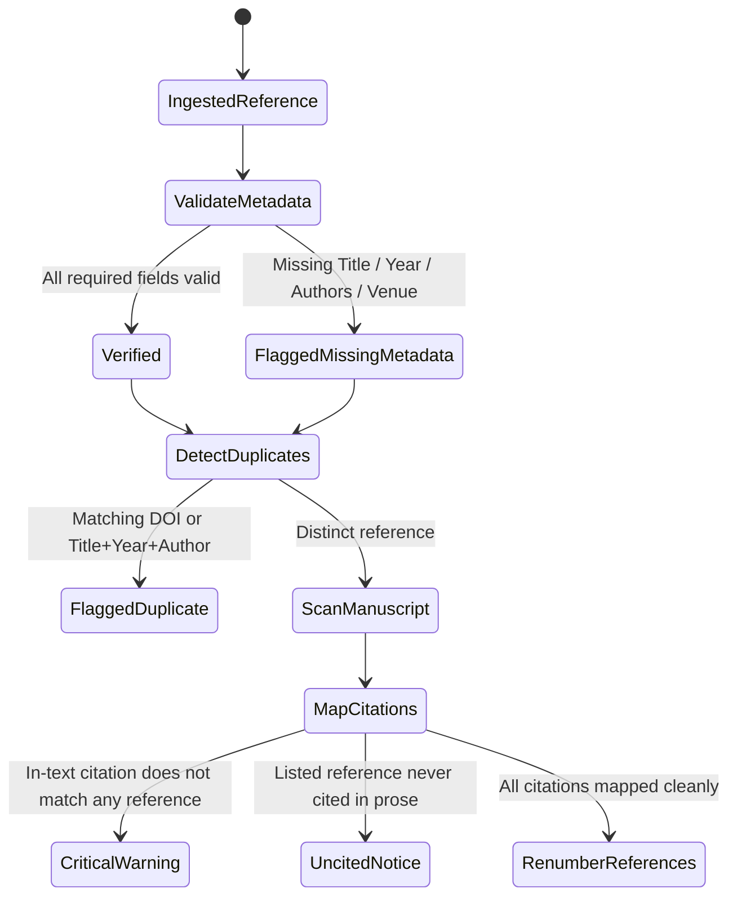

# 37 — IEEE Reference, Citation Management and Bibliography Engine

## 1. Executive Summary and Architecture

Resbud implements an end-to-end, structured academic citation and reference management pipeline modeled strictly on official IEEE citation and publication standards. Bibliographic references in Resbud are never treated as arbitrary generated text paragraphs. Every reference is a validated, structured object linked to in-text citations throughout the manuscript with complete provenance and verification guarantees.



---

## 2. Structured Reference Model

Every bibliographic reference in Resbud contains up to 16 structured attributes supporting all 11 recognized IEEE publication types:

### Core Data Model (`ReferenceInput` / `ReferencePayload`)

| Attribute | Type | Description |
| :--- | :--- | :--- |
| `id` | `ReferenceId` | Unique alphanumeric identifier (e.g., `ref_1`, `ref_vaswani`). |
| `text` | `string` | Formatted bibliographic text or user-provided citation string. |
| `raw_text` | `string \| null` | Unprocessed source reference or BibTeX entry. |
| `authors` | `list[string] \| null` | Clean author names formatted as `['A. Author', 'B. Author']`. |
| `year` | `int \| null` | 4-digit Gregorian publication year (e.g., `2024`). |
| `title` | `string \| null` | Primary title of article, paper, book, report, or standard. |
| `venue` | `string \| null` | Journal name, conference proceedings, or website portal. |
| `volume` | `string \| null` | Volume number (e.g., `vol. 12` or `2nd ed.`). |
| `issue` | `string \| null` | Issue number, patent number, or report ID (e.g., `no. 3`). |
| `pages` | `string \| null` | Exact page span formatted with en-dash (e.g., `100–115`). |
| `publisher` | `string \| null` | Academic publisher or institutional sponsor (e.g., `IEEE`, `ACM`). |
| `doi` | `string \| null` | Normalized Digital Object Identifier (`10.NNNN/...`). |
| `url` | `string \| null` | Canonical electronic access URL. |
| `isbn_or_issn` | `string \| null` | International Standard Book/Serial Number. |
| `access_date` | `string \| null` | Verification or access date for electronic resources (e.g., `Jan. 15, 2024`). |
| `publication_type` | `PublicationType` | One of the 11 supported IEEE publication categories. |
| `provenance` | `ProvenanceType` | Origin: `crossref`, `openalex`, `semantic_scholar`, `doi_org`, `user_supplied`. |
| `verification_status`| `VerificationStatus` | Audit state: `verified`, `unverified`, `incomplete`, `flagged_missing_metadata`. |
| `citation_number` | `int \| null` | 1-based sequential citation index assigned by first appearance. |
| `citation_locations` | `list[string]` | Section IDs where this reference is cited. |
| `is_cited` | `bool \| null` | Whether the reference is cited in the manuscript text. |
| `review_warning` | `string \| null` | Descriptive editorial review warning for author attention. |

---

## 3. Supported IEEE Publication Types & Formatting

Resbud formats each publication type according to official IEEE citation guidelines:

```
1. Journal Article:
[1] A. Turing and C. Shannon, "On Computable Numbers and Information Entropy", IEEE Transactions on Information Theory, vol. 12, no. 3, pp. 100–115, 2024, doi: 10.1109/TIT.2024.1234567.

2. Conference Paper:
[2] A. Vaswani, N. Shazeer, and N. Parmar, "Attention Is All You Need", in Proc. Advances in Neural Information Processing Systems, 2017, pp. 5998–6008, doi: 10.5555/3295222.3295349.

3. Book:
[3] D. Knuth, The Art of Computer Programming, 3rd ed., Addison-Wesley, 1997.

4. Book Chapter:
[4] G. Hopper, "Compiling Routines", in High-Level Language Systems, Academic Press, 1981, pp. 45–62.

5. Thesis / Dissertation:
[5] B. Liskov, "A Program for Computer Translation", Ph.D. dissertation, Dept. Computer Science, Stanford University, 1968.

6. Technical Report:
[6] L. Lamport, "Time, Clocks, and the Ordering of Events", Massachusetts Computer Associates, Tech. Rep. CA-7603-2911, 1976.

7. Standard:
[7] IEEE Standard for Ethernet, IEEE Std 802.3-2022, 2022.

8. Patent:
[8] N. Tesla, "System of Electrical Distribution", U.S. Patent 381,970, 1888.

9. Website / Online Portal:
[9] T. Berners-Lee, "Information Management: A Proposal", World Wide Web Consortium, 1989. [Online]. Available: https://www.w3.org/History/1989/proposal.html. [Accessed: Jan. 10, 2024].

10. Software Documentation:
[10] "NumPy Reference Guide", NumPy Developers, Version 1.26, 2023. [Online]. Available: https://numpy.org/doc/stable/.

11. Preprint (arXiv):
[11] G. Hinton and O. Vinyals, "Distilling the Knowledge in a Neural Network", arXiv:1503.02531, 2015.
```

### IEEE Author Formatting Rules
1. **Single author**: `A. Author`
2. **Two authors**: `A. Author and B. Author`
3. **Three to six authors**: `A. Author, B. Author, and C. Author`
4. **More than six authors**: `A. Author et al.`
5. **Nobiliary particles**: Particles like `von`, `van`, `de`, `der`, and `du` are preserved in lowercase (e.g., `J. von Neumann`).

---

## 4. In-Text Citations & First-Appearance Numbering

IEEE style mandates that references are numbered sequentially in order of their **first appearance** in the manuscript text:

- If Reference $C$ is cited before Reference $A$, Reference $C$ receives citation number `[1]`, and Reference $A$ receives `[2]`.
- Uncited references are appended at the end of the bibliography with `is_cited = False` and an advisory `REFERENCE_INCOMPLETE` warning.

### IEEE In-Text Citation Grouping Rules

| In-Text Citation Type | IEEE Standard Example | Implementation Rule |
| :--- | :--- | :--- |
| **Single citation** | `[1]` | Single bracketed number. |
| **Pair of citations** | `[1], [2]` | Separated by comma and space. |
| **Consecutive range ($\ge 3$)** | `[1]–[3]` | Collapsed with en-dash `–` or hyphen `-`. |
| **Non-consecutive multiple** | `[1], [3], [5]` | Comma-separated bracketed numbers in ascending order. |
| **Mixed ranges & singles** | `[1]–[3], [5], [7]–[9]` | Consecutive clusters collapsed, isolated citations separate. |

### Elimination of Author-Date Citations
Author-date citations such as `(Smith, 2024)` or `(Vaswani et al., 2017)` are strictly forbidden in IEEE style. The citation manager matches author-date patterns against supplied references, rewrites them to the corresponding `[N]` numeric citation, and flags an informational audit notice.

---

## 5. Citation-Reference Integrity & Zero-Fabrication Guarantee

The automated citation validator enforces strict academic integrity:



1. **Zero Fabrication**: If a reference is missing authors, year, title, or venue, Resbud **never invents** values to make the paper appear complete. Instead, it marks the reference with `verification_status="flagged_missing_metadata"` and produces an explicit `ReviewWarning`.
2. **Unresolved Citations**: In-text citations to unsupplied references (e.g., `[ref_unknown]`) produce a **critical** `CITATION_NEEDED` warning specifying the exact section heading and citation token.
3. **Duplicate Detection**: Identical DOIs, URLs, or normalized `(title, year, author)` signatures are detected and flagged.

---

## 6. Authoritative Resolution Adapters

Resbud includes `BibliographicResolver` for fetching verified bibliographic metadata:
- **DOI Normalization**: Normalizes `https://doi.org/10.xxxx`, `http://dx.doi.org/10.xxxx`, and `doi: 10.xxxx` into standard `10.xxxx/...` format.
- **Crossref Adapter**: Maps Crossref work items (`title`, `author`, `container-title`, `issued`, `page`, `volume`, `DOI`) directly into `ReferenceInput`.
- **OpenAlex Adapter**: Maps OpenAlex work objects (`authorships`, `primary_location`, `biblio`, `doi`) into `ReferenceInput`.
- **Authoritative Pre-Cached Registry**: High-integrity offline fixtures for standard landmark publications ensure repeatable test execution without external rate limits or network dependencies.

---

## 7. Mobile Reference Management Interface

The Flutter mobile application (`mobile/lib/features/paper_editor/paper_editor_page.dart`) provides a dedicated interactive reference manager:

1. **Interactive Reference Card**:
   - Total references count badge.
   - **+ Add Reference** button.
   - Uncited reference warning alert banner listing all orphaned references.
   - Incomplete metadata advisory banner for references requiring author completion.
2. **Item Display**:
   - Number badge: `[N]`.
   - Category chip: `JOURNAL ARTICLE`, `CONFERENCE PAPER`, `BOOK`, `WEBSITE`, `PREPRINT`.
   - Citation status chip: `Cited in Introduction, Methodology` (green) vs `Uncited` (amber).
   - Verification status chip: `Verified` (green) vs `Incomplete` (orange).
   - Clickable DOI link.
3. **Editor Actions**:
   - **Add Reference Modal**: Full form with ID, publication type selector, title, authors, year, venue, DOI, and URL.
   - **Edit Reference Modal**: Pre-populated editor to resolve missing information.
   - **Delete Reference**: Confirmation dialog and clean deletion with dirty state tracking.

---

## 8. Native DOCX & PDF Export Formatting

### DOCX Exporter
- **Heading**: Dedicated `REFERENCES` heading (unnumbered, centered, small caps in IEEE conference mode).
- **Hanging Indent**: Exact IEEE hanging indent formatting:
  - IEEE two-column: `0.22 in` left indent, `-0.22 in` first line indent, 8.5 pt Times New Roman.
  - Standard academic: `0.3 in` left indent, `-0.3 in` first line indent, 9.5 pt Times New Roman.
- **Native Text**: Exported as true text runs with bold `[N]` bracketed prefix, italicized journal/book titles, and valid DOI strings.

### PDF Exporter
- **Heading**: Dedicated unnumbered `References` / `REFERENCES` heading.
- **ReportLab Styles**: Configured with `leftIndent=16`, `firstLineIndent=-16`, 8.5 pt font size, and 11 pt line leading in two-column IEEE mode (or `leftIndent=24`, `firstLineIndent=-24`, 9.5 pt font size in standard mode).
- **Zero Screenshots**: 100% vector typography with selectable text.

---

## 9. Verification and Test Results

| Test Suite | Tests | Result | Status |
| :--- | :---: | :---: | :---: |
| `backend/tests/test_ieee_reference_engine.py` | 12 | **12 / 12 Passed** | All 11 publication types, ordering, range collapsing, duplicate detection, DOI validation, DOCX/PDF export verified. |
| `mobile/test/ieee_reference_engine_test.dart` | 3 | **3 / 3 Passed** | Payload serialization, copyWith metadata editing, draft immutability verified. |
| Backend Full Pytest Suite | 242 | **242 / 242 Passed** | Zero regressions across contracts, generation API, integrity, and exporters. |
| Ruff & Mypy Checkers | 52 files | **0 Errors** | Strict type compliance verified. |
