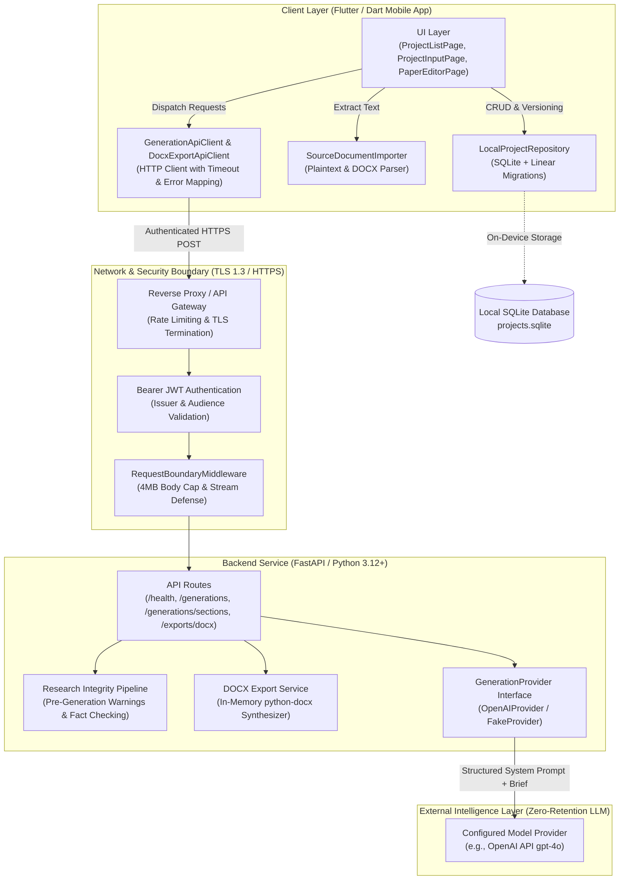

# 02 — System Architecture, Data Flow, and Technology Rationale

---

## 1. System Architecture Diagram

---

## 2. Key Data Flows and Trust Boundaries

### 2.1 Trust Boundary Invariants

1. **Client Trust Boundary**:
   - The client environment (user's mobile or desktop operating system) is the sole permanent store of user intellectual property.
   - Provider API keys and secret bearer signing keys **never** touch the mobile application bundle or client assets.
2. **Transport Boundary**:
   - All network calls occur over TLS 1.3 / HTTPS. Cleartext HTTP is restricted to local offline development loops.
   - Payloads are bounded to 4 MiB to prevent denial-of-service memory exhaustion.
3. **Backend Trust Boundary**:
   - The backend acts as a **stateless processing conduit**. It maintains no database, no session files, and no disk persistence for research material.
   - Logging redaction guarantees zero user research sentences, draft paragraphs, or generated papers appear in stdout/stderr.
4. **External Provider Boundary**:
   - Only sanitized research briefs and structured section instructions are transmitted to the external model adapter.
   - Calls use strict token bounds (`provider_max_output_tokens` default: 12,000) and timeouts (5s connect, 90s read).

---

## 3. Technology Selection and Architectural Rationale

### 3.1 Flutter (Mobile Client)
- **Rationale**: Flutter provides cross-platform client compilation from a single Dart codebase. Its reactive widget tree enables real-time visual feedback for dirty state tracking, input validation, side-by-side section comparison diffs, and responsive layout re-organization across narrow mobile viewports and tablets.
- **Independence**: All client storage and business logic are tested headless on Linux without requiring proprietary mobile OS simulators.

### 3.2 FastAPI & Python 3.12+ (Backend)
- **Rationale**: FastAPI pairs native async event loop performance (Starlette/Uvicorn) with strict declarative schema validation (Pydantic v2).
- **Contract Enforcement**: FastAPI auto-generates compliant OpenAPI 3.1.0 specifications from Pydantic types, ensuring that client transport contracts, JSON Schemas, and backend validation rules never drift.

### 3.3 Local-First SQLite Persistence
- **Rationale**: Academic research drafts contain sensitive, unpatented, and embargoed findings. Storing projects on-device by default ensures students and researchers maintain physical sovereignty over their work.
- **Version Tracking**: Linear SQLite migrations support immutable snapshot versioning (`paper_versions` table), enabling instant time-travel and rollback without complex cloud sync infrastructure.

### 3.4 Provider Abstraction (`GenerationProvider`)
- **Rationale**: Decouples domain drafting policies from commercial API vendors.
- **Deterministic Testing**: Enables complete vertical slice testing using `FakeProvider` in CI without incurring token fees, network flakiness, or privacy hazards.
- **Vendor Portability**: Allows switching between OpenAI, local self-hosted models (e.g. vLLM), or mock providers without touching business logic or client code.

### 3.5 Bounded In-Memory DOCX Generation
- **Rationale**: DOCX is the de facto standard format for academic advisor feedback, journal peer review submissions, and word processing.
- **Security**: Synthesizing the DOCX file strictly in memory via `python-docx` and streaming it as a binary attachment avoids temporary server file leaks and file system traversal vulnerabilities.
