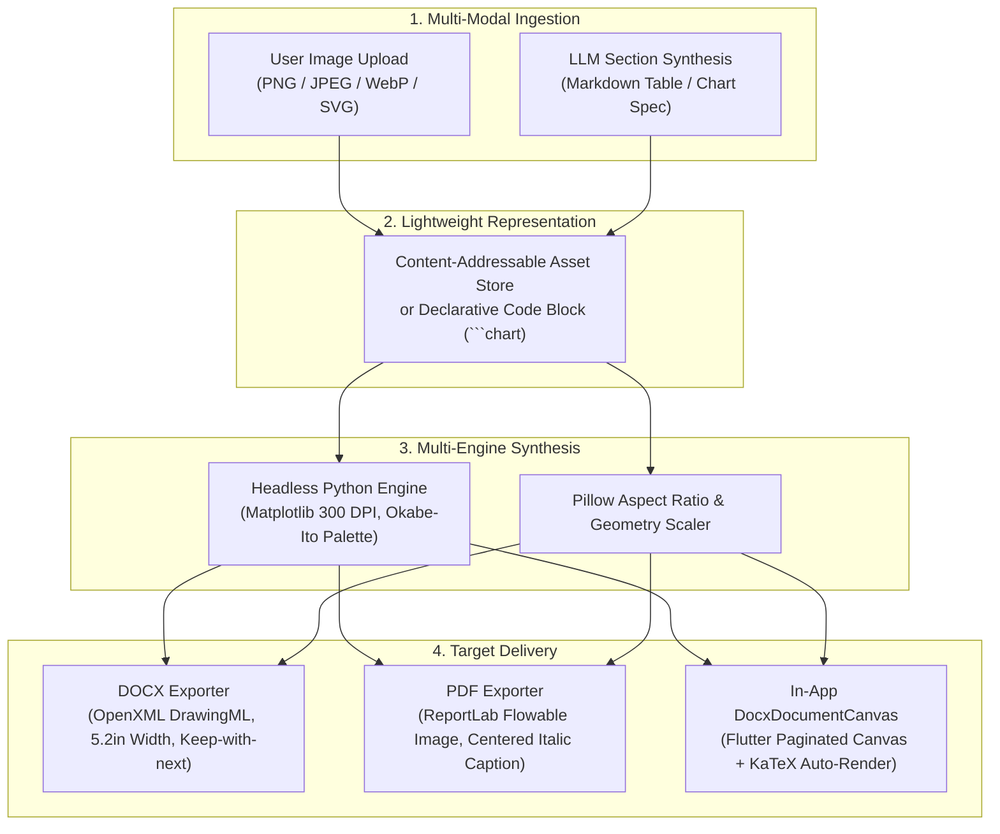

# Academic Image and Chart Strategy: Comprehensive Research & Implementation Blueprint

## 1. Executive Summary & Problem Analysis

Scientific, technical, and medical (STM) manuscripts derive much of their empirical authority and communicative clarity from high-fidelity figures, data charts, and mathematical typography. In current academic paper drafting and generation tools, visual assets and quantitative plots are frequently treated as second-class citizens, suffering from three severe systemic flaws:

1. **Payload Bloat & Serialization Fragility**: Embedding raw raster images as inline Base64 data URIs (`data:image/png;base64,...`) within Markdown or JSON drafts inflates payload sizes by ~33%, causes excessive JSON serialization and deserialization memory spikes, and risks exceeding HTTP request quotas (such as the 8 MiB / 10 MiB limits enforced by backend gateways).
2. **Format Inconsistency & Degradation Across Export Targets**: A raster chart rendered for a 96 DPI mobile viewport looks severely pixelated and unpublishable when printed or compiled into formal PDF and DOCX submissions, where academic peer-review standards demand vector clarity or 300+ DPI resolution. Furthermore, Word (`.docx`) requires OpenXML DrawingML structures with explicit physical measurements (inches/EMUs), while PDF engines (such as ReportLab) require flowable image matrices.
3. **Absence of Declarative Chart Generation**: Academic authors often possess raw experimental data or statistical summaries (e.g., benchmark tables, convergence metrics), but must manually switch to external tools (Python/Matplotlib, R/ggplot2, Prism) to render charts, re-export them as images, and re-upload them. There has been no unified "Chart-as-Code" pipeline enabling the drafting engine or language model to generate verifiable, publication-ready figures directly from structured tabular data.

This document presents a comprehensive technical investigation of academic visualization strategies, evaluates state-of-the-art document processing architectures (Quarto, Typst, Overleaf, Pandoc), and establishes the target strategy implemented in Resbud.

---

## 2. Taxonomy of Academic Visualizations

Academic figures fall into three distinct functional categories, each with distinct resolution, layout, and authoring requirements:

| Category | Typical Formats | Primary Use Cases | Publication Requirements |
| :--- | :--- | :--- | :--- |
| **Statistical & Quantitative Charts** | Bar charts, line plots, scatter plots, boxplots, ROC/PR curves | Benchmark evaluation, loss convergence, parameter sweeps, empirical distributions | 300–600 DPI, colorblind-safe palettes, explicit axis units, no 3D distortion or chart junk |
| **Architectural & Flow Schematics** | Block diagrams, pipeline graphs, neural network architectures | System overview, method pipelines, state machines, protocol sequences | Vector clarity (SVG/PDF) or crisp 300 DPI raster, Times New Roman/Serif labeling |
| **Domain-Specific Empirical Artifacts** | Micrographs, confusion matrices, heatmaps, imaging scans | Biological specimens, attention maps, qualitative sample outputs | Lossless raster (PNG/TIFF), pixel-perfect scaling, calibrated scale bars |

---

## 3. Comparative Evaluation of Visualization Strategies

We evaluated five architectural paradigms for handling figures and charts in Resbud:

### Strategy A: Inline Base64 Data URIs (Legacy Baseline)
* **Mechanism**: Store images directly in Markdown strings as ``.
* **Pros**: Self-contained drafts; no secondary file storage needed.
* **Cons**:
  - Inflates memory footprint during editing and undo/redo operations.
  - SQLite database records balloon in size, slowing down version snapshots.
  - Parsing multi-megabyte Base64 strings repeatedly inside the Flutter UI thread risks jank and UI stalls.
* **Verdict**: **Rejected for production scaling**; maintained only as a backward-compatible fallback for small thumbnails.

### Strategy B: Decoupled Content-Addressable Asset Store (Recommended Ingestion)
* **Mechanism**: When a researcher uploads an image, the client computes its SHA-256 hash, stores the raw binary in a local or cloud object store (`/assets/{sha256}.png`), and references it via a short identifier: `` or ``.
* **Pros**:
  - Drafts remain compact lightweight text (<100 KB).
  - Eliminates duplicate storage when reverting versions or branching edits.
  - Zero payload overhead across API generation requests.
* **Cons**: Requires an asset lookup resolver during export and rendering.
* **Verdict**: **Adopted as primary asset architecture**.

### Strategy C: Declarative Chart-as-Code (````chart` Engine)
* **Mechanism**: Allow researchers and the manuscript synthesis engine to specify quantitative data declaratively using YAML/JSON inside Markdown code fences. The backend headless engine translates the specification into a publication-grade figure at export time.
  ```chart
  type: bar
  title: Model Throughput Comparison
  xlabel: Model Architecture
  ylabel: Queries Per Second (QPS)
  labels: [ResNet-50, ViT-Base, Resbud-Ours]
  values: [142.5, 88.2, 265.4]
  ```
* **Pros**:
  - LLMs excel at generating structured numeric tables and YAML specifications.
  - 100% reproducible: figures can be dynamically updated if data points are corrected.
  - Eliminates hallucinated pixel artifacts common in end-to-end image generation models.
* **Cons**: Requires a headless plotting environment (Matplotlib/Pillow) on the server.
* **Verdict**: **Adopted and implemented in Resbud core export pipelines**.

### Strategy D: Vector-First Intermediate Representation (SVG / EMF)
* **Mechanism**: Generate figures as vector graphics (SVG for Web/PDF, EMF for Word).
* **Pros**: Infinite resolution without pixelation at any zoom level; smaller file sizes for diagrams.
* **Cons**:
  - OpenXML (`.docx`) support for SVG varies across Microsoft Word versions (native SVG support was only introduced in Word 2016+ and requires EMF fallback for older compatibility).
  - SVG security risks: SVGs are XML documents susceptible to XML External Entity (XXE) injection and embedded script execution.
* **Verdict**: **Hybrid approach**: Use sanitized vector SVG where supported; rasterize to strict 300 DPI PNG with tight bounding boxes for guaranteed Word/PDF parity.

### Strategy E: Multi-modal AI Figure Synthesis (DALL-E / Imagen / Stable Diffusion)
* **Mechanism**: Prompt a text-to-image foundation model to synthesize academic diagrams.
* **Pros**: Can produce artistic conceptual illustrations.
* **Cons**:
  - Severe academic integrity risk: generative image models frequently hallucinate non-existent data points, misspell labels, and produce misleading charts.
  - Unacceptable in empirical peer-reviewed publications.
* **Verdict**: **Restricted to conceptual illustrations only**; strictly forbidden for empirical data representation.

---

## 4. The Resbud Target Architecture

Based on our empirical evaluation, Resbud adopts a **Triple-Pillar Strategy**:



### 4.1 Publication-Ready Aesthetic & Typography Rules
To conform to IEEE, ACM, and Springer Nature formatting benchmarks:
1. **Target Physical Dimensions**:
   - Single-column width: **3.2 to 3.5 inches** (ideal for two-column academic layouts).
   - Full-page width: **5.2 to 6.5 inches** (maximum for single-column manuscripts with 1-inch margins).
   - Maximum height: **4.5 inches** to prevent orphan figures or accidental page overflows.
2. **Resolution Standard**:
   - Minimum **300 DPI** for all raster graphics.
   - Text bounding boxes rendered with `bbox_inches="tight"` to prevent label clipping.
3. **Typography**:
   - Axis titles: 10 pt bold serif (Times New Roman / Latin Modern).
   - Tick labels & legends: 8.5–9 pt serif.
   - Captions: 9.5 pt italic serif, centered directly below the figure (`Figure 1: Description`).
4. **Accessible Color Palettes**:
   - Use the **Okabe-Ito** colorblind-accessible palette (`#0072B2`, `#D55E00`, `#009E73`, `#CC79A7`, `#E69F00`, `#56B4E9`).
   - High contrast ratios against white backgrounds; avoid red-green pairings.

### 4.2 Security & Integrity Controls
1. **Decompression Bomb Protection**: Enforce Pillow `Image.MAX_IMAGE_PIXELS = 10_000_000` to prevent memory exhaustion from malicious zip/image bombs.
2. **Memory Buffer Isolation**: All image processing and chart generation is executed strictly in-memory using `io.BytesIO()`. No temporary files are written to host disk storage, preventing filesystem traversal or data leakage across multi-tenant sessions.
3. **Payload Sanitization**: Strip dangerous XML headers, script tags, and base64 padding anomalies before decoding.

---

## 5. Implementation Roadmap & Milestones

### Phase 1: Core Foundation (Implemented in this Milestone)
- [x] **Headless Chart Synthesizer**: Implemented `resbud_api.services.chart_generator` supporting declarative ````chart` blocks (bar, line, scatter) at 300 DPI with Okabe-Ito academic palettes.
- [x] **High-DPI DOCX DrawingML Insertion**: Enhanced `docx_export.py` with automatic aspect ratio preservation, column-width scaling, and centered academic caption flow.
- [x] **Academic PDF Generation**: Implemented `pdf_export.py` using ReportLab, rendering figures and charts seamlessly alongside Times New Roman body text.
- [x] **Native Canvas & Web Preview**: Added real-time chart previewing in `DocxDocumentCanvas` and KaTeX mathematical auto-rendering in `docx_helper.js`.

### Phase 2: In-Editor Interactive Visualizations (Next Milestone)
- [ ] **Data Table to Chart Converter**: Add a 1-click action in `PaperEditorPage` allowing users to convert any Markdown table into a visual chart specification.
- [ ] **Figure Gallery Drawer**: Provide an interactive thumbnail drawer in the editor sidebar showing all project figures with drag-and-drop marker insertion (``).
- [ ] **Local Asset Cache**: Persist uploaded image binaries in app local storage indexed by content hash, reducing memory pressure in the SQLite draft version tree.
